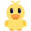
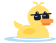
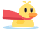

### hey, I'm donald 👋

I'm a software engineer with a passion for building things that help make lives easier!

- 💼 2x sde intern @ amazon, prev @ boeing
- 🏆 mlh top 50 hacker
- 🎓 ubc cs & physics (final year)

  
  

<!-- DICE:START -->
<h3 align="center"> Duck race · round 1</h3>

  

<a href="https://github.com/DonaldKLee/DonaldKLee/issues/new?title=dice%7Croll%7Cshades&body=%F0%9F%91%87%20hit%20the%20green%20%2A%2ACreate%2A%2A%20button.%20that%27s%20it%21%20No%20need%20to%20edit%20anything%20here%2C%20close%20any%20issues%2C%20etc%21%0A%0A-%20%F0%9F%8E%B2%20a%20bot%20will%20roll%20for%20your%20duck%20and%20reply%20here%20within%20~30%20seconds%0A-%20%F0%9F%8F%81%20first%20duck%20to%20the%20finish%20wins%20the%20round%0A-%20%F0%9F%A4%9D%20you%27re%20on%20team%20shades%20until%20the%20round%20ends"></a>&nbsp;&nbsp;<a href="https://github.com/DonaldKLee/DonaldKLee/issues/new?title=dice%7Croll%7Ctophat&body=%F0%9F%91%87%20hit%20the%20green%20%2A%2ACreate%2A%2A%20button.%20that%27s%20it%21%20No%20need%20to%20edit%20anything%20here%2C%20close%20any%20issues%2C%20etc%21%0A%0A-%20%F0%9F%8E%B2%20a%20bot%20will%20roll%20for%20your%20duck%20and%20reply%20here%20within%20~30%20seconds%0A-%20%F0%9F%8F%81%20first%20duck%20to%20the%20finish%20wins%20the%20round%0A-%20%F0%9F%A4%9D%20you%27re%20on%20team%20cape%20until%20the%20round%20ends"></a>

<b> shades is up by 5.  cape needs you!</b>

pick a duck and roll. you're on its team until the round ends.

**points**

- 🎲 +1 for every roll
- 🔥 +1 for each day in a row you've rolled, once a day (max +5)
- 🤝 +3 if your duck wins the round

**squares:** 🍞 bread +2 · 🐛 bug −3 · 🚀 ship it +3 · 🌀 whirlpool −4 · 💤 nap −2

💨 a duck that's 6+ squares behind gets +1 on every roll.

**🏆 leaderboard**

| | player | pts | 🔥 streak |
|:-:|:--|:-:|:-:|
| 🥇 |  [@DonaldKLee](https://github.com/DonaldKLee) | **2** | 1 |

not in the top 10? find yourself on the <a href="game/leaderboard.md">full leaderboard</a> (1 players)

<b>recent rolls</b> · rounds won: shades 0, cape 0

- nov 14 · [@DonaldKLee](https://github.com/DonaldKLee) rolled ⚄ **5** for 🕶️ shades

<!-- DICE:END -->
